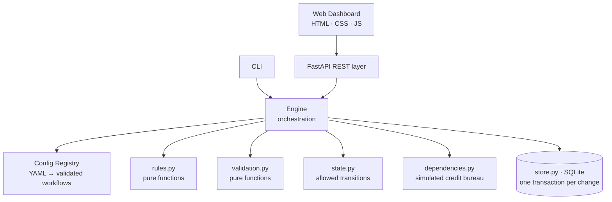
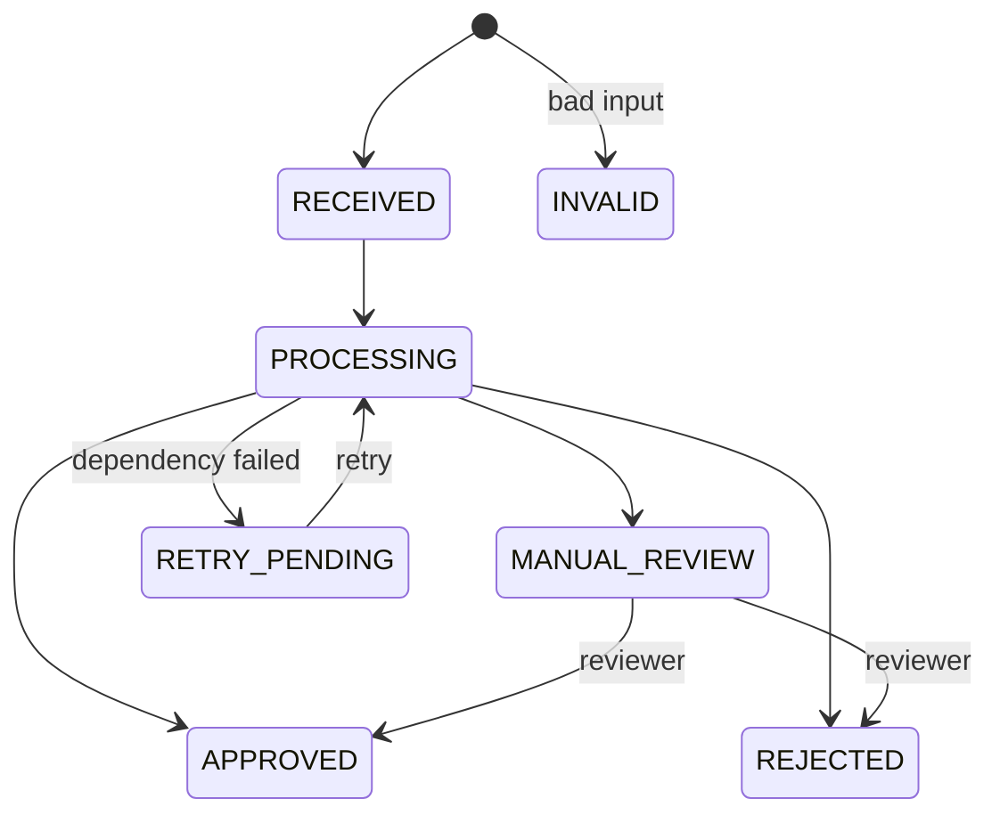

<div align="center">

# ⚖️ Configurable Workflow Decision Platform

**A YAML-driven decision engine that approves, rejects, escalates or retries requests, and can explain every single decision.**


[Quick Start](#-quick-start) · [Architecture](#-architecture) · [Features](#-key-features) · [API](#-rest-api) · [Dashboard](#-web-dashboard) · [Design Decisions](#-engineering-decisions) · [Limits](#-known-limits)

</div>

---

## 🎯 The Problem

Loan approval, claim handling and vendor onboarding all share one skeleton: **validate → check rules → call an outside system → decide → keep a record of why.** Only the rules and thresholds change, and they change constantly.

This project separates the two. The **engine is written once**; each **workflow is a YAML file** holding its schema, rules and stages. Adding a whole new workflow, vendor approval, took **zero Python changes**.

## ✨ Key Features

| | Feature | What it means |
|---|---|---|
| 🧩 | **Zero-code configurability** | Change a threshold or add a workflow by editing YAML; hot-reload without restart |
| 🔍 | **Explainable decisions** | Every decision stores the rule trace: rule, actual vs expected value, passed / failed / skipped |
| 🔁 | **Idempotency** | Duplicate submits return the original result; same key with a different payload returns `409` |
| 🛡️ | **Failure-safe by design** | Retries with backoff, atomic transactions, and a saved dependency result is never called twice |
| 👤 | **Human-in-the-loop** | Borderline cases go to `MANUAL_REVIEW`; a reviewer approves or rejects with a note |
| 📜 | **Full audit trail** | Append-only history of every state change, rule evaluation and dependency attempt |
| 🧭 | **Change-tolerant** | Each request stores the config hash it ran under, so old decisions stay explainable |
| 🖥️ | **Web dashboard** | Dynamic forms, live rule trace, audit timeline, review and retry buttons |

## 🏗️ Architecture



**Design rule:** rules and validation are pure functions with no I/O, the store owns all SQL, and the engine has no SQL and no HTTP. Rules can be tested without a database, and SQLite can be swapped for Postgres inside one file.

### Request lifecycle



Every transition is checked against an allowed-transition table, so a bug cannot silently create an impossible state.

## 📋 A Workflow Is Just YAML

```yaml
rules:
  minimum_age:
    type: threshold
    field: age
    op: gte
    value: 18
    on_fail: reject            # reject always wins over manual_review

  self_employed_documents_verified:
    type: threshold
    field: documents_uploaded
    op: eq
    value: true
    on_fail: manual_review
    when: {field: employment, op: eq, value: self_employed}   # conditional rule

stages:
  - {name: mandatory_checks, type: rules,    rules: [pan_present, minimum_age, minimum_income], next: credit_check}
  - {name: credit_check,     type: external, dependency: credit_bureau, max_attempts: 2, backoff_seconds: 0.2, on_error: retry, next: risk_rules}
  - {name: risk_rules,       type: rules,    rules: [credit_score_minimum, loan_to_income_ratio, self_employed_documents_verified], next: APPROVE}
```

**Operators:** `exists` `eq` `neq` `gte` `gt` `lte` `lt` `in` `not_in` · **Rule types:** `mandatory`, `threshold` · **Outcomes:** `reject`, `manual_review`

Two workflows ship in the box: **`application_approval`** (loan or card, with a credit bureau stage) and **`vendor_approval`** (sanctions and financial checks).

## 🚀 Quick Start

Requires Python 3.10+.

```bash
python -m venv .venv
source .venv/bin/activate          # Windows: .venv\Scripts\activate
pip install -r requirements.txt

pytest -q                          # run test suite
python scripts/run_demo.py         # runs 7 scenarios → examples/decision_examples.md
```

**Run the full platform (API + dashboard):**

```bash
python scripts/start_all.py
# Dashboard   → http://localhost:3000
# API + docs  → http://127.0.0.1:8000/docs
```

Or run each service separately:

```bash
# Run Backend API (Port 8000):
python scripts/start_backend.py

# Run Frontend UI (Port 3000):
python scripts/start_frontend.py
```

To simulate a credit bureau outage: `SIMULATE_CREDIT_BUREAU_FAILURES=2` (the first two calls fail).

## 🔌 REST API

| Method | Path | Purpose | Status codes |
|---|---|---|---|
| `POST` | `/requests` | Submit (optional `Idempotency-Key` header) | `201` new · `200` duplicate · `404` unknown workflow · `409` key conflict · `422` invalid |
| `GET` | `/requests` | List historical requests (filter by `workflow`) | `200` |
| `GET` | `/requests/{id}` | Current state | `200` · `404` |
| `GET` | `/requests/{id}/decision` | Decision, reasons, rule trace, facts | `200` · `404` |
| `GET` | `/requests/{id}/audit` | State history and every audit event | `200` · `404` |
| `POST` | `/requests/{id}/retry` | Resume a `RETRY_PENDING` request | `200` · `409` |
| `POST` | `/requests/{id}/review` | Human approve or reject | `200` · `409` · `422` |
| `GET` | `/workflows` | Loaded workflows and rules | `200` |
| `GET` | `/workflows/{name}` | Workflow details (rules, stages, input schema) | `200` · `404` |
| `POST` | `/workflows/reload` | Reload YAML, keeping old config if new is broken | `200` · `400` |
| `GET` | `/stats` | System-wide metrics and request counts | `200` |
| `GET` | `/examples` | Pre-built test payloads for workflows | `200` |
| `GET` | `/health` | Liveness | `200` |

<details>
<summary><b>Try it with curl</b></summary>

```bash
curl -s -X POST localhost:8000/requests \
  -H 'Content-Type: application/json' -H 'Idempotency-Key: demo-1' \
  -d '{"workflow":"application_approval","data":{"applicant_id":"APP-1001","full_name":"Asha Rao","age":30,"income":60000,"pan":"ABCDE1234F","loan_amount":20000,"employment":"salaried"}}'

# Same key again → 200, duplicate=true, no second bureau call
curl -s localhost:8000/requests/<request_id>/decision
curl -s localhost:8000/requests/<request_id>/audit
curl -s -X POST localhost:8000/requests/<request_id>/review \
  -H 'Content-Type: application/json' -d '{"decision":"approve","reviewer":"Ravi","note":"verified"}'
```
</details>

<details>
<summary><b>Use the command line</b></summary>

```bash
python scripts/run_cli.py submit --workflow application_approval --file examples/inputs/approved.json
python scripts/run_cli.py decision <request_id>
python scripts/run_cli.py review <request_id> --decision approve --reviewer "Ravi" --note "verified"
python scripts/run_cli.py audit <request_id>
python scripts/run_cli.py workflows
python scripts/run_cli.py --fail-bureau 2 submit --workflow application_approval --file examples/inputs/approved.json
```
</details>

## 🖥️ Web Dashboard

Plain HTML, CSS and JavaScript, with **no external dependencies**.

- **Dynamic forms** generated from each workflow's `input_schema`, plus one-click sample scenarios
- **Decision inspector** showing the outcome, reasons and computed facts
- **Rule trace visualizer** with the condition, actual vs expected value and status of every rule
- **Audit timeline** of all lifecycle events
- **Manual review and retry** actions directly in the UI
- **KPI cards, request history** and a live view of the workflow stage pipeline

## 🧪 Testing and Demo Scenarios

**35 automated tests** cover engine behaviour, rules and config, and the HTTP API, including the hard cases: rollback after a partial save failure, no repeat bureau call after a crash, concurrent duplicate keys, and a threshold change altering a decision with no code change.

| Input | Demonstrates | Result |
|---|---|---|
| `approved.json` | Valid input, credit score 720 | ✅ `APPROVED` |
| `invalid.json` | Missing field, wrong type, bad enum, unknown field | ⛔ `INVALID` (422) |
| `rejected_underage.json` | Age 17; bureau never called | ❌ `REJECTED` |
| `manual_review.json` | Bureau returns 600 | 👤 `MANUAL_REVIEW` |
| `self_employed_no_docs.json` | Conditional rule fires | 👤 `MANUAL_REVIEW` |

`python scripts/run_demo.py` also replays duplicate requests, a dependency failure then retry, and a requirement change (minimum score 650 → 750), and writes every decision with its audit trail to [`examples/decision_examples.md`](examples/decision_examples.md).

## 🧠 Engineering Decisions

| Concern | Approach |
|---|---|
| **Duplicate requests** | `UNIQUE` idempotency key; a concurrent loser catches `IntegrityError` and returns the winner |
| **Partial save failure** | State change, history, audit rows and decision commit in **one transaction** (`BEGIN IMMEDIATE` … `ROLLBACK` on error) |
| **No repeated external calls** | A successful dependency response is persisted immediately and reused on retry |
| **Dependency outage** | Retry with linear backoff, then `RETRY_PENDING` (or `MANUAL_REVIEW` if configured) |
| **Crash mid-run** | The request stays at its last committed stage and can be resumed via `/retry` |
| **Bad config** | Unknown rules, stages or operators are rejected at load time; a broken reload keeps the previous config |
| **Auditability** | `state_history`, `audit_events` (append-only) and `decisions` answer *how*, *what* and *why* |

## 📁 Clean Project Layout

```text
ScoreMe-Project/
├── README.md
├── requirements.txt, pytest.ini, .gitignore
├── Dockerfile, Procfile, render.yaml, fly.toml   (kept at root: cloud hosts look for them there)
├── config/          workflow definitions (YAML): schema, rules, stages
│   ├── application_approval.yaml
│   └── vendor_approval.yaml
├── src/decision/    core decision engine
│   ├── config.py
│   ├── validation.py
│   ├── rules.py
│   ├── state.py
│   ├── dependencies.py
│   ├── store.py
│   ├── engine.py
│   └── factory.py
├── backend/         dedicated FastAPI REST API server
│   ├── main.py
│   ├── requirements.txt
│   └── README.md
├── frontend/        interactive web UI dashboard (zero external npm dependencies)
│   ├── index.html
│   ├── styles.css
│   ├── app.js
│   ├── server.js
│   ├── package.json
│   └── README.md
├── tests/           automated unit & integration test suite
├── examples/        sample input payloads and decision outputs
├── scripts/         executable convenience utilities
│   ├── run_demo.py
│   ├── run_cli.py
│   ├── start_all.py
│   ├── start_backend.py
│   └── start_frontend.py
└── docs/            project documentation
    ├── ARCHITECTURE.md
    └── DEPLOYMENT.md
```

Deployment options (Docker, Render, Fly.io, instant public URL) are in [docs/DEPLOYMENT.md](docs/DEPLOYMENT.md). Design notes and trade-offs are in [docs/ARCHITECTURE.md](docs/ARCHITECTURE.md).

## ⚠️ Known Limits

Stated honestly, with the production path for each:

- **SQLite, single process.** Concurrent processes on one request are not protected. Production: Postgres with row locks, or a queue.
- **No background worker.** Retry and review happen on request. Production: queue and workers for automatic retries.
- **Simulated credit bureau.** Fixed responses for a few applicant IDs, 720 for everyone else. Real services plug in through the `check()` interface.
- **No authentication.** Out of scope; reviewer roles would be added next.

## 🔭 Roadmap

- [ ] Postgres store and background workers
- [ ] Role-based access for reviewers
- [ ] Richer rule expressions combining multiple fields
- [ ] Real third-party integrations

---

<div align="center">

**Built by [Amit Kumar](https://github.com/AmitK241)** · Final-year B.Tech CSE, MNNIT Allahabad

</div>
